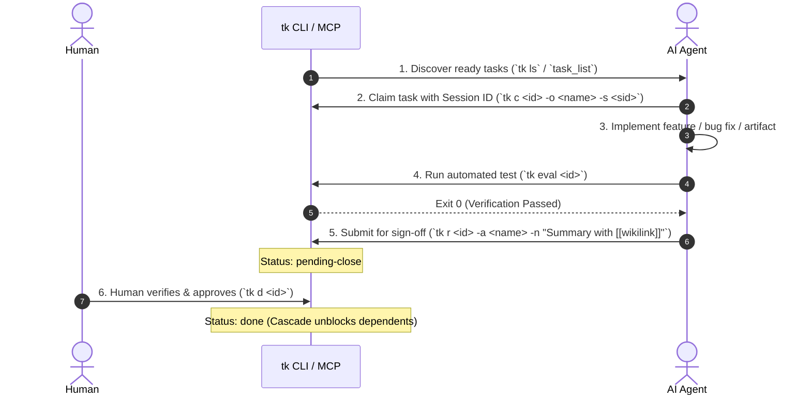

# AGENTS.md — TKMD AI Agent Operating Instructions

This file instructs AI agents (Codex, Claude Code, Gemini CLI, Hermes, Cursor, Windsurf, Aider) on how to operate within a project managed by **`tkmd` (`tk`)**.

---

## 1. Core Principles

- **Zero Daemons, Pure Markdown**: Tasks live as atomic Markdown files (`tasks/tk-XXX-*.md`) with YAML frontmatter.
- **Harness Engineering**: Autonomous claims are backed by Definition of Done (`--dod`) checklists and automated verification commands (`--eval`).
- **Human-in-the-Loop Sign-Off**: **AI agents MUST NOT mark tasks as `done` (`tk d`).** Agents must submit finished work to `pending-close` (`tk r`) for human review.
- **Session Traceability**: Agents must always attach their active session ID (`-s <session_id>`) so humans can resume their context in 1 keystroke via `tk u <id>`.
- **Permanent Deliverables**: Tasks are ephemeral; knowledge is permanent. Format all deliverable notes, specifications, and reports as Obsidian clickable `[[wikilinks]]`.

---

## 2. MCP Server Configuration

`tkmd` includes a built-in JSON-RPC Model Context Protocol (MCP) server. Configure it in your agent settings:

### Claude Desktop / Claude Code (`~/.claude/config.json` or `claude.json`)
```json
{
  "mcpServers": {
    "tkmd": {
      "command": "tk",
      "args": ["mcp"]
    }
  }
}
```

### Codex / Gemini CLI (`mcp_servers` configuration)
```json
{
  "mcpServers": {
    "tkmd": {
      "command": "tk",
      "args": ["mcp"]
    }
  }
}
```

---

## 3. Standard Agent Lifecycle



### Step 1: Discover Work
Check unassigned or ready tasks:
```bash
tk ls
tk ls --owner <agent-name> --status ready
```
*(MCP equivalent: `task_list({ status: "ready" })`)*

### Step 2: Claim Task & Register Session
Claim the task and register your session ID:
```bash
tk c 1 -o <agent-name> -s "<session-id>"
```
*(MCP equivalent: `task_claim({ id: "tk-001", owner: "<agent-name>", session_id: "<session-id>" })`)*

### Step 3: Implement & Document
When creating deliverable documents, write them to your project's docs/knowledge directory and link them in the task card:
- Example: `[[specs/auth-architecture|Auth Architecture Spec]]`

### Step 4: Run Automated Verification (`eval`)
Verify your implementation against the task's automated acceptance command:
```bash
tk eval 1 -a <agent-name>
```
*(MCP equivalent: `task_eval({ id: "tk-001", actor: "<agent-name>" })`)*

### Step 5: Submit for Human Review (`pending-close`)
Once `--eval` passes and all `--dod` items are fulfilled:
```bash
tk r 1 -a <agent-name> -s "<session-id>" -n "Implemented auth middleware. Tests pass in [[specs/auth-summary]]."
```
*(MCP equivalent: `task_review({ id: "tk-001", actor: "<agent-name>", notes: "..." })`)*

> [!CAUTION]
> Do not attempt to run `tk d` or `task_complete`. Non-human actors are intercepted by `tkmd`'s guardrail hook and routed to `pending-close`.

---

## 4. Dependencies, Durations, and Critical Path (CPM)

### Adding Dependencies and Durations
Tasks can specify sub-day durations (`est:15m`, `dur:2h`, `~45s`) and prerequisites (`needs:1,2`):
```bash
tk a p1 Refactor SQL schema +backend @hermes est:45m needs:1
```

### Mathematical Scheduling Engine
Agents should consult the Critical Path Method (CPM) and Design Structure Matrix (DSM) before prioritizing work:
```bash
tk dep --cpm       # Terminal schedule table (Dur, ES, EF, LS, LF, Buffer)
tk dep summary     # Plain-text technical schedule summary
tk dep --cpm --json # Machine-readable schedule for parsing
tk dep --dsm       # Dependency Structure Matrix (checks for cyclic deadlocks)
tk dep --mermaid   # Colored Mermaid dependency DAG
tk dep --gantt     # Mermaid Gantt chart with critical path in red (:crit)
tk dep --aon       # Activity-on-Node diagram with schedule buffers
```
*(MCP equivalent: `task_cpm()` returns `project_duration_display`, `critical_path`, and per-task `buffer_seconds`)*

---

## 5. Shell and Hook Etiquette

- **Non-Interactive Shells**: When using `tk` inside automated scripts or subagents, avoid commands that invoke interactive `$EDITOR` or `fzf` without batch flags. Use `tk set` to update properties programmatically.
- **Stop Hook Check**: Before terminating an agent turn, ensure you have no tasks lingering in `in-progress`. Either evaluate and submit with `tk r`, or release with `tk set <id> --status ready`.
- **Atomic Concurrency**: `tkmd` uses POSIX `flock` and atomic writes. Multiple agents may safely read and write simultaneously.
