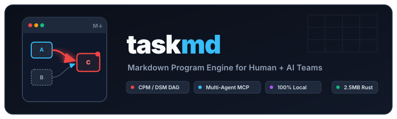
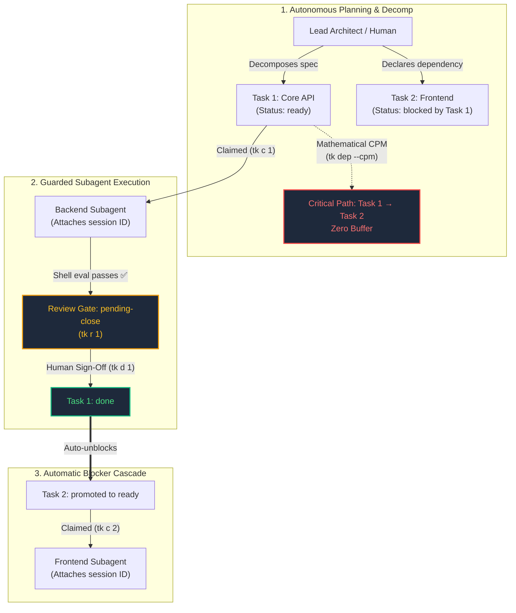

<p align="center">
  
</p>

<p align="center">
  <b>Deterministic Program Engine for Developers and AI Agents</b><br>
  <i>Local Markdown cards • Mathematical CPM &amp; DSM • Universal Stdio MCP</i>
</p>

---

## What is tkmd?

**`tkmd` (CLI: `tk` / `tkmd`) is a deterministic program engine and multi-agent governance harness.**

It stores every task as a plain Markdown card (`.md`) with YAML frontmatter in `tasks/tk-XXX-*.md`. It uses mathematical graph algorithms (Critical Path Method and Design Structure Matrices) to schedule work, calculate schedule buffers, and surface circular deadlocks.

When you pair with AI coding agents (Claude Code, Codex, Gemini, OpenCode), `tkmd` prevents agents from falsely claiming work is finished. Agents must pass automated shell verification gates (`eval`) and submit work for human sign-off (`pending-close`) before a task can transition to `done`.

<p align="center">
  
</p>

### Why Use tkmd?

- **100% Local & Offline**: No cloud accounts, no subscriptions, and zero background daemons. Single Rust binary with POSIX advisory file locking.
- **AI Agent Guardrails**: Subagents cannot skip straight to `done`. They must pass automated shell tests and submit work to `pending-close`, with a receipt tying the pass to the exact output. Only a person at a terminal signs off. See [Human Sign-Off](docs/design.md#human-sign-off).
- **Mathematical Scheduling**: Calculates early start, early finish, schedule buffers, and the Critical Path (`tk dep --cpm`) deterministically.
- **Blocker & Loop Detection**: View dependency trees (`tk tree`) and circular deadlocks (`tk dep --dsm`) in terminal colors.
- **One-Command Session Resume**: Reopen the exact AI terminal session attached to any task (`tk u <id>`).
- **Flexible Storage**: Manage repository-level tasks (`tk init -L`) or central Obsidian Kanban boards (`bases/tasks.base`).
It supports two first-class local setups:
1. **Obsidian + CLI Mode (Recommended)** — Syncs 1:1 with an Obsidian `.base` Kanban board (`bases/tasks.base`), updates `.obsidian/types.json`, and logs completed tasks under `## Task List` in your Daily Note.
2. **Standalone CLI Mode** — Pure plain-text Markdown cards in a local directory (`~/.local/share/tkmd/tasks` or `~/tasks`), opening directly in `$EDITOR` (`hx`, `nvim`, `micro`, `vim`) with zero Obsidian dependency.

### 100% Local & Offline Privacy
- **Zero Network**: `tkmd` makes zero network/HTTP requests and has zero telemetry beacons. No accounts, no cloud sync, no tracking.
- **Plain-Text Data Ownership**: Every task is an open `.md` file; every event is an open `.jsonl` record on your local disk.
- **Self-Contained Telemetry**: `tk st` computes Little's Law, MTTC, and TPM90 directly in Rust. DuckDB is **not required** to run `tkmd`, but because the event log is standard `.jsonl`, users can optionally run instant SQL queries with DuckDB (`duckdb -c "SELECT * FROM 'tasks/.events.jsonl'"`).

---

## Autonomous Multi-Agent Planning & Orchestration

`tkmd` acts as a deterministic scheduling and governance harness for teams of AI subagents. It solves the three hardest problems in multi-agent execution: **deadlocks**, **uncoordinated parallel writes**, and **premature completion claims**.



### How the Multi-Agent Lifecycle Works

1. **Topological Planning (No Circular Loops)**:
   A lead architect agent decomposes an epic into tasks. Running `tk dep --dsm` runs cycle detection across the dependency matrix, catching circular deadlocks before coding starts.
2. **Mathematical CPM Allocation**:
   `tk dep --cpm` computes early start (ES), late finish (LF), and schedule buffers. The orchestrator prioritizes subagents on zero-buffer Critical Path tasks.
3. **Collision-Free Concurrent Execution**:
   Multiple subagents running concurrently across separate terminal panes or CLI processes claim independent tasks (`tk c <id>`). POSIX advisory file locking prevents write collisions without a database server.
4. **Automated Verification Gates (`eval`)**:
   Subagents running autonomously cannot skip `pending-close`. A subagent must run automated verification (`tk eval <id>`) and submit work for review (`tk r <id>`). Only human sign-off (entered directly or instructed as a proxy) marks a task `done`.
5. **Cascade Unblocking & Session Resumption**:
   When human sign-off marks a blocker `done` (`tk d <id>`), `tkmd` automatically promotes downstream blocked tasks to `ready`. If any subagent stalls, `tk u <id>` immediately resumes its conversation session.

---

## 1. Install `tkmd`

### Option A: Standalone Binary (No Rust Required)

```bash
curl -fsSL https://raw.githubusercontent.com/ktreharrison/tkmd/main/install.sh | sh
```

### Option B: Build from Source with Cargo (Rust)

```bash
# Install directly from crates.io (or git):
cargo install tkmd

# Or build locally from cloned repository:
cargo install --path .
```

`Cargo.toml` declares two binary targets: `tkmd` and `tk`. Running `cargo install tkmd` installs both binaries to `~/.cargo/bin/`:

```bash
tkmd --help
# Or use the ergonomic 2-letter alias:
tk --help
```

### Binary Naming & Collision Avoidance (`wedow/ticket` and Grafana Tanka)

The short command `tk` is also claimed by:
1. **`wedow/ticket`**: A Git-backed markdown issue tracker that installs a binary named `tk`.
2. **Grafana Tanka (`grafana/tanka`)**: The Kubernetes Jsonnet configuration tool whose official Homebrew package installs `/opt/homebrew/bin/tk`.

To eliminate silent namespace collisions and PATH clobbering, the crate and primary binary is named **`tkmd`**, with **`tk`** provided as a first-class co-installed binary. Every command, flag, and MCP capability functions identically under both `tkmd` and `tk`. If your workstation already has Grafana Tanka or `wedow/ticket` installed, you can invoke `tkmd` directly or set a customized shell alias (`alias tkm="tkmd"`).


### Shell Auto-Completion

`tkmd` generates native completion scripts for Zsh, Bash, Fish, PowerShell, and Elvish. In Zsh, a single script enables tab-completion for both `tkmd` and `tk`:

```bash
# Zsh (add to ~/.zshrc for instant completion):
eval "$(tkmd completions zsh)"

# Or persist to your Zsh completion directory:
tkmd completions zsh > ~/.zfunc/_tkmd

# Bash:
source <(tkmd completions bash)

# Fish:
tkmd completions fish > ~/.config/fish/completions/tkmd.fish
```

---

## 2. Local Setup (`tk init`)

You can run the interactive setup wizard at any time:

```bash
tk init
```

Or initialize non-interactively with flags:

### Option A: Obsidian 1.14 + CLI (Recommended)

```bash
tk init --obsidian --path ~/Vault --base bases/tasks.base --daily journals/daily
```

What this configures automatically:
- Creates `<vault>/tasks/` (e.g. `~/Vault/tasks/`) for atomic Markdown task cards (`tk-001-*.md`).
- Creates `<vault>/bases/tasks.base` with 5 pre-configured Obsidian 1.14 Base views:
  1. **Kanban Board** (grouped by `status`: `ready`, `in-progress`, `pending-close`, `blocked`, `done`)
  2. **Pending Close (Sign-Off Queue)** (`status == "pending-close"`)
  3. **Your Personal Queue** (`owner == "<you>"`)
  4. **Agent Queues** (`owner != "<you>"`)
  5. **Completed Tasks** (`status == "done"`)
- Safely merges task property types (`id`, `status`, `priority`, `owner`, `project`, `due`, `dod`, `eval`, `eval_status`) into `.obsidian/types.json` without overwriting your existing vault properties.
- Writes `~/.config/tkmd/config.toml` so `tk o` opens `bases/tasks.base` directly in Obsidian.

### Option B: Standalone CLI Mode (No Obsidian Required)

```bash
tk init --cli --path ~/.local/share/tkmd
```

What this configures automatically:
- Creates `~/.local/share/tkmd/tasks/` for Markdown task cards and `.events.jsonl`.
- Disables Obsidian URI calls and Daily Note mutations (`mode = "cli"`).
- Routes `tk o` (`tk open`) and `tk e <id>` (`tk edit`) directly to your `$EDITOR` (defaults to Helix `hx`).

### Option C: Local Repository / Project Backlog (`tk init -L`)

```bash
tk init -L
```

What this configures automatically:
- Writes `.tkmd.toml` in your current repository root.
- Creates `./tasks/` and `./tasks/.events.jsonl` local to the project.
- Automatically detected by `tk` commands in that directory or its subdirectories.
- Retains instant access to the central global vault via `-G` or merged view via `-A`.

---

## 3. Scope Control (Local Project vs. Global Vault)

`tkmd` seamlessly manages both local project-level backlogs and central global backlogs:

| Flag | Scope | Description |
| :--- | :--- | :--- |
| *(default)* | Auto | Uses `./tasks` if inside a project with `.tkmd.toml` or `tasks/`; otherwise uses global vault |
| `-L, --local` | Local | Force operation strictly on the current repository's `./tasks` backlog |
| `-G, --global` | Global | Force operation strictly on the global central vault (`~/Documents/tasks`) |
| `-A, --all-scopes` | Merged | Aggregate local and global tasks across dashboards, CPM schedules, and telemetry |

In merged view (`tk -A`), task IDs display distinct scope indicators (`tk-001L` for local, `tk-001G` for global) without column drift. Mutative commands (`tk d`, `tk c`, `tk r`) target the exact card on disk regardless of active working directory.

## 4. Daily Ergonomics (1-Letter Shortcuts)

| Command | Shortcut | Action |
| :--- | :--- | :--- |
| `tk` | `tk` | Render the responsive terminal dashboard + `pending-close` review banner |
| `tk watch` | `tk w` | Live auto-resizing dashboard (reflows on pane resize or file change) |
| `tk review` | `tk r` | Dedicated sign-off dashboard displaying pending local and global tasks |
| `tk review 1 -n "All checks green"` | `tk r 1` | Move task to `pending-close` (auto-runs `eval` gate) |
| `tk done 1 -n "Verified"` | `tk d 1` | Sign off and close task (`status: done` + Daily Note entry in Obsidian mode) |
| `tk done 1 2 3` / `tk done --pending` | `tk d --pending` | Bulk sign-off: one summary and one confirmation; a task that fails its checks is skipped and reported |
| `tk add p1 Fix auth +app @ken due:tomorrow` | `tk a ...` | Create a task card using `todo.txt` shorthand (`p0`/`p1`/`p2`, `+project`, `sid:<id>`) |
| `tk claim 1 --owner claude -s 8y9380573586` | `tk c 1` | Claim `tk-001` (`status: in-progress`) and attach agent `session_id` |
| `tk resume 1` | `tk u 1` | Resume the AI agent session attached to `tk-001` (`claude -r <id>`, `codex resume <id>`, etc.) |
| `tk eval 1` | `tk eval 1` | Execute the card's `eval` shell command and log `[PASS]` / `[FAIL]` |
| `tk find [query]` / `tk find -i` | `tk f` | Fuzzy search tasks (inline table or interactive `fzf` picker + `bat` preview) |
| `tk history [id]` | `tk h` | Event audit log from `tasks/.events.jsonl` with step duration deltas |
| `tk stats` | `tk st` | Flow telemetry: Little's Law, MTTC, P50/P90/TPM90, agent split, yield |
| `tk tree` | `tk tree` | Render dependency DAG tree for active tasks (also `tk dep tree`) |
| `tk dep [id] --needs [ids]` | `tk dep` | Dependencies: CPM table (`--cpm`), text summaries (`--short`, `--long`, `--summary`), colored JSON (`--json`), tree, DSM (`--dsm`), Gantt (`--gantt`), AON (`--aon`) |
| `tk archive [id]` | `tk archive` | Move completed tasks to `tasks/archive/` (preserves `.events.jsonl` DB) |
| `tk prune [id] [-f]` | `tk prune` | Remove completed/archived cards from disk (preserves `.events.jsonl` DB) |
| `tk set 1 -t "Title" -p p0` | `tk set 1` | Update title, priority, owner, due, DoD, or eval directly from CLI |
| `tk edit 1` | `tk e 1` | Edit the Markdown card in `$EDITOR` (`hx`) |
| `tk open` / `tk open 1` | `tk o` / `tk o 1` | Open `bases/tasks.base` (or `tk-001`) in Obsidian (or `$EDITOR` in CLI mode) |

---

## 5. Connect AI Agents via MCP (`tkmd mcp` or `tk mcp`)

`tkmd mcp` runs a dual-framing JSON-RPC 2.0 MCP server over `stdio` (auto-detecting both newline-delimited JSON and `Content-Length` headers for universal compatibility across Claude Desktop, Codex, Gemini CLI, Cursor, Zed, OpenCode, and Pi).

Add this to your agent's MCP configuration:

```json
{
  "mcpServers": {
    "tkmd": {
      "command": "tkmd",
      "args": ["mcp"]
    }
  }
}
```

### Bundled Agent Skill (`skills/tkmd`)

`tkmd` ships with a pre-configured agent skill in `skills/tkmd/SKILL.md` (and `skills/tkmd/agents/openai.yaml`).

Install it into your agent workspace:

```bash
# For Codex, Claude, Antigravity, OpenCode, Pi:
mkdir -p ~/.agents/skills
cp -r skills/tkmd ~/.agents/skills/
```

This enforces the task governance harness across all your agents:
- Automatic session registration (`-s <session_id>`) for instant resumption (`tk u <id>`).
- Mandatory review gate: agents must submit completed tasks to `pending-close` (`tk r`) instead of `done`.
- Automated eval assertion passes before review submission (`tk eval`).
- DoD deliverable note links (`[[wikilinks]]`).

---

## 5. Event Stream (`tasks/.events.jsonl`) & Optional DuckDB Queries

`tk` records every state transition, eval verification, and agent session in an append-only, newline-delimited JSON stream (`tasks/.events.jsonl`).

`tk st` and `tk h` parse this file natively without any external database. However, because it is standard `.jsonl`, users with `duckdb` installed can run instant SQL analytics with zero setup or database importing:

```bash
# Recent event transitions
duckdb -c "SELECT timestamp, id, action, actor, from_status, to_status, eval_passed FROM read_json_auto('~/Documents/tasks/.events.jsonl') ORDER BY timestamp DESC;"

# Agent review yield
duckdb -c "SELECT actor, count(*) as reviews, count(CASE WHEN eval_passed THEN 1 END) as passed FROM read_json_auto('~/Documents/tasks/.events.jsonl') WHERE action = 'pending-close' GROUP BY actor;"
```

---

## 6. License

`tkmd` is dual-licensed under:

- **MIT License** ([LICENSE-MIT](LICENSE-MIT))
- **Apache License, Version 2.0** ([LICENSE-APACHE](LICENSE-APACHE))

You may choose either license at your option. Copyright &copy; 2026 Ken Harrison.

