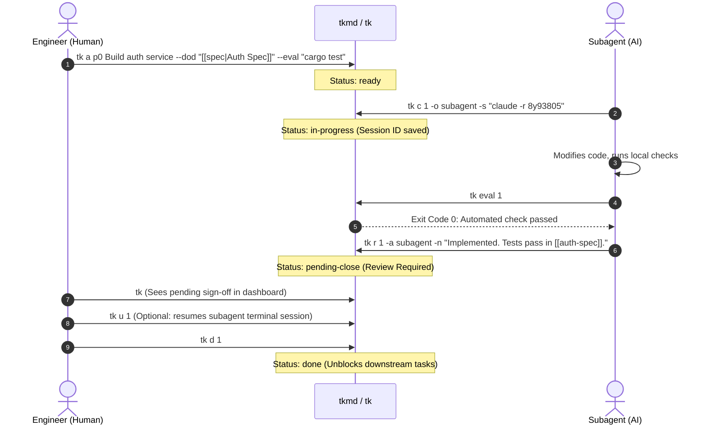

# tkmd: Architecture and Design

A single-binary Markdown program management engine and multi-agent governance harness.

---

## 1. Why tkmd?

Modern software development increasingly involves autonomous AI coding agents (Claude Code, Codex, Hermes, Gemini CLI) working alongside engineers. However, traditional project management tools and flat issue trackers fail in multi-agent workflows:

1. **Context Evaporation**: When an agent finishes a terminal run or its context window compacts, its working state disappears. Engineers must search shell logs to find which session produced which changes.
2. **Unverified Completion**: Language models frequently report tasks as complete even when unit tests fail or edge cases break. Issue trackers lack machine-verifiable gates.
3. **Deadlocks and Scheduling Blindspots**: When agents work concurrently on interdependent tasks, topological deadlocks and bottleneck tasks halt execution.

I built **`tkmd`** (invoked as `tk` or `tkmd`) to solve these issues. It is a standalone, zero-daemon Rust executable that treats local Markdown files as the single source of truth for both humans and AI agents.

### Binary Naming and Collision Avoidance

The short command `tk` is already claimed by two existing tools:
- **`wedow/ticket`**: A Git-backed markdown issue tracker.
- **Grafana Tanka (`grafana/tanka`)**: A Kubernetes configuration utility whose Homebrew package installs `/opt/homebrew/bin/tk`.

To avoid silent path collisions and namespace conflicts on crates.io and package managers, the crate and primary binary is named **`tkmd`**. It simultaneously installs **`tk`** as a co-located binary for 2-letter daily ergonomics. If you already have Grafana Tanka or `ticket` installed, invoke `tkmd` directly or configure a custom alias.

---

## 2. Core Architecture

```
┌────────────────────────────────────────────────────────┐
│                      Human User                        │
│           (CLI · Obsidian Kanban · Helix · fzf)        │
└───────────────┬────────────────────────▲───────────────┘
                │                        │
     `tk a` / `tk c` / `tk d`    `tk ls` / `tk dep`
                │                        │
┌───────────────▼────────────────────────┴───────────────┐
│               tkmd Engine (`tk` / `tkmd`)              │
│               Single Static Rust Executable            │
│                                                        │
│  ┌──────────────────┐  ┌────────────────────────────┐  │
│  │ Single-Host      │  │  Deterministic Math        │  │
│  │ POSIX flock      │  │  • CPM Critical Path       │  │
│  │ + Atomic Renames │  │  • DSM Matrix (Deadlocks)  │  │
│  └────────┬─────────┘  │  • Second Precision (u64)  │  │
│           │            └─────────────▲──────────────┘  │
└───────────┼──────────────────────────┼─────────────────┘
            │                          │
┌───────────▼──────────────────────────┴─────────────────┐
│               Local Filesystem Storage                 │
│   • `tasks/tk-XXX.md`      (YAML Frontmatter + Specs)  │
│   • `tasks/.events.jsonl`  (Append-Only Event Ledger)  │
│   • `bases/tasks.base`     (Obsidian 1.14 Kanban)      │
└───────────▲────────────────────────────────────────────┘
            │
    `tk mcp` (Stdio JSON-RPC)
            │
┌───────────┴────────────────────────────────────────────┐
│                    AI Agents                           │
│        (Codex · Claude Code · Hermes · Gemini)         │
└────────────────────────────────────────────────────────┘
```

### Local Storage and Concurrency

- **Atomic File Operations**: Every task is stored as an individual Markdown card (`tasks/tk-001-*.md`). Writes use temporary file creation followed by atomic rename (`std::fs::rename`) to prevent partial writes.
- **Single-Machine Advisory Locking**: To coordinate multiple concurrent subagent processes on a local workstation, `tkmd` uses POSIX advisory file locking via `libc::flock(fd, LOCK_EX)`. Locks are scoped per-file and released immediately after mutations.
- **Append-Only Event Ledger**: State transitions, claims, eval results, and reviews are written to `tasks/.events.jsonl`. This log serves as the audit trail for telemetry.

### Dual Backlog Scopes

Engineering workflows require separation between repository-specific tasks and cross-project global initiatives:

1. **Local Repository (`./tasks/`)**: Initialized via `tk init -L`. Stores project tasks versioned directly in git. Automatically detected when running `tk` inside the repository.
2. **Global Vault (`~/Documents/tasks` or `~/.local/share/tkmd/tasks`)**: Stores system-wide tasks and cross-cutting programs.
3. **Scope Selection**: Use `-L` (`--local`) for project scope, `-G` (`--global`) for global vault, or `-A` (`--all-scopes`) to aggregate both without column drift.

---

## 3. Human-in-the-Loop Governance



### Review Gate: `pending-close`

Autonomous agents must not unilaterally close tasks. `tkmd` enforces a review transition:

- When an agent completes its implementation, it executes `tk eval <id>` to run the card's automated shell test.
- If the test exits 0, the agent runs `tk r <id>` (`tk review`), moving the task to `pending-close`.
- **Guardrail Enforcement**: If an agent attempts to call `tk d` or the MCP `task_complete` tool directly, `tkmd` intercepts the call and forces the status to `pending-close`. Even if an agent omits the `--actor` flag or defaults to the workspace owner, any task owned by an agent that has not yet completed human review is redirected to `pending-close`.
- Only a human sign-off (`tk d <id>`) marks the task `done`, checks off Definition of Done (`--dod`) items, and cascade-unblocks downstream dependencies.

### Session Resumption (`tk u <id>`)

When an agent claims work (`tk c <id>`), it records its active session command:
```bash
tk c 02 -o hermes -s "hermes -r 8y9380573586"
```
During review, the engineer can resume that exact conversation context with a single command:
```bash
tk u 02
```
`tkmd` executes the registered command, reconnecting directly to the agent's interactive terminal.

---

## 4. Deterministic Graph Scheduling: CPM & DSM

Rather than relying on language model estimations for project timelines, `tkmd` computes schedules using graph algorithms implemented in Rust.

### Sub-Day Durations

Tasks declare duration estimates using compact tokens (`dur:45m`, `est:2h`, `~15s`). All internal duration arithmetic is standardized in 64-bit seconds (`u64`).

### Critical Path Method (CPM)

Running `tk dep --cpm` executes a two-pass topological sort:
- **Forward Pass**: Calculates Early Start (ES) and Early Finish (EF).
- **Backward Pass**: Calculates Late Start (LS) and Late Finish (LF).
- **Schedule Buffer**: Calculates total buffer (`LS - ES`). Tasks with zero buffer are designated as the Critical Path.

```
🎯 CRITICAL PATH & SCHEDULE ANALYSIS (CPM)
Mathematical schedule calculated from dependencies and durations.

  ID      Dur   ES    EF    Buffer Condition  Owner      Title
  ──────────────────────────────────────────────────────────────────────────────
  tk-001  45m   0s    45m   0s     CRITICAL   @data-eng  Build database schema
  tk-002  30m   45m   1h15m 0s     CRITICAL   @api-eng   Implement auth service
  tk-003  20m   0s    20m   55m    BUFFER:55m @frontend  Design login page
  ──────────────────────────────────────────────────────────────────────────────

  Project Duration: 1h15m
  Critical Path:    tk-001 ➔ tk-002
  Summary:          2 of 3 tasks on critical path (zero buffer).
```

### Dependency Structure Matrix (DSM)

To detect circular dependencies and ordering issues before execution begins, `tk dep --dsm` computes an $N \times N$ matrix:

```
📐 DEPENDENCY STRUCTURE MATRIX (DSM)
Read each ROW: "This task needs Column [#] to complete first"

  #   ID       1  2  3  Task Title (Status)
  ────────────────────────────────────────────────────────
   1  tk-001   ·        Build database schema (done)
   2  tk-002   X  ·     Implement auth service (in-progress)
   3  tk-003      X  ·  End-to-end integration test (blocked)
  ────────────────────────────────────────────────────────
  Legend: X = Prerequisite | · = Self
  ✓ Clean Execution Order: No circular dependencies or deadlocks detected.
```
Any mark above the diagonal indicates a feedback loop or circular deadlock.

---

## 5. Event Telemetry and Flow Analytics

Every card mutation logs a structured JSON record to `tasks/.events.jsonl`:

```json
{"timestamp":"2026-10-18T18:12:40Z","id":"tk-001","action":"pending-close","actor":"hermes","session_id":"8y9380573586","from_status":"in-progress","to_status":"pending-close","eval_passed":true,"title":"Build database schema"}
```

Running `tk st` computes summary metrics in memory:
- **WIP & Throughput**: Active work-in-progress and completion rates.
- **Cycle Time & Lead Time**: Active implementation duration versus total queue lifespan.
- **Review Latency**: Duration spent waiting in `pending-close` for human sign-off.
- **Verification Yield**: Percentage of tasks with passing automated `eval` commands.

Because the ledger is newline-delimited JSON, external analysis requires no ETL. Engineers can query it directly using DuckDB:

```bash
duckdb -c "SELECT actor, count(*) as completed FROM read_json_auto('tasks/.events.jsonl') WHERE action = 'completed' GROUP BY actor;"
```

---

## 6. Stdio Model Context Protocol (MCP)

`tkmd mcp` provides a standard Model Context Protocol server over `stdio`, supporting both newline-delimited JSON and `Content-Length` framing.

Key exposed tools:
- `task_list`: Filter tasks by status, owner, priority, or project.
- `task_claim`: Assign an agent and register a session ID.
- `task_eval`: Trigger automated shell test commands.
- `task_submit_review`: Transition tasks to `pending-close` with output artifacts.
- `task_cpm`: Retrieve calculated project duration, critical path sequences, and task buffers without running shell commands.

Agents interact with task state strictly through typed MCP tool calls, keeping coordination deterministic across heterogeneous model fleets.
