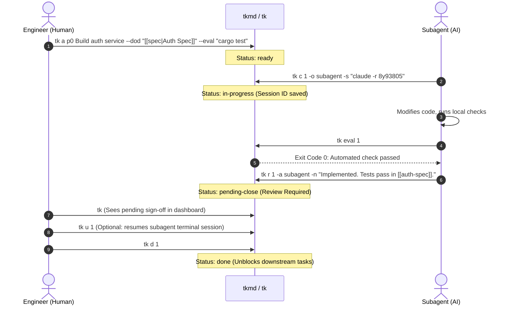

# tkmd: Technical Design Document

This document describes the architecture and design of `tkmd`.
`tkmd` is a single-binary program management engine and AI agent governance system.
It stores tasks in local Markdown files.

---

## 1. Problem Description

Software development teams use autonomous AI coding agents (Claude Code, Codex, Hermes, Gemini CLI).
Standard issue trackers cause three problems in multi-agent workflows:

1. **Loss of Session State**: When an agent session stops, its working memory disappears. The user cannot easily find the correct session log.
2. **Unverified Task Completion**: AI models frequently mark tasks done when tests fail. Standard issue trackers do not run automated verification commands.
3. **Schedule Deadlocks**: Multiple agents work on dependent tasks at the same time. If dependencies have circular references, work stops.

`tkmd` solves these problems.
It runs as a local static executable without a background daemon.
It uses plain Markdown files as the single source of truth for humans and AI agents.

### Binary Names and Collision Avoidance

The short command name `tk` is already used by two tools:
- **`wedow/ticket`**: A Git-based issue tracker that uses `tk`.
- **Grafana Tanka (`grafana/tanka`)**: A Kubernetes tool that installs `/opt/homebrew/bin/tk`.

To prevent name collisions, the package name and primary executable is **`tkmd`**.
The package also installs a second executable named **`tk`** for short daily commands.
If you already use Grafana Tanka or `ticket`, use `tkmd` directly or configure an alias.

---

## 2. System Architecture

```
┌────────────────────────────────────────────────────────┐
│                      Human User                        │
│           (CLI · Obsidian Kanban · Helix · fzf)        │
└───────────────┬────────────────────────▲───────────────┘
                │                        │
     `tk a` / `tk c` / `tk d`    `tk ls` / `tk dep`
                │                        │
┌───────────────▼────────────────────────┴───────────────┐
│               tkmd Engine (`tk` / `tkmd`)              │
│               Single Static Rust Executable            │
│                                                        │
│  ┌──────────────────┐  ┌────────────────────────────┐  │
│  │ Single-Host      │  │  Deterministic Math        │  │
│  │ POSIX flock      │  │  • CPM Critical Path       │  │
│  │ + Atomic Renames │  │  • DSM Matrix (Deadlocks)  │  │
│  └────────┬─────────┘  │  • Second Precision (u64)  │  │
│           │            └─────────────▲──────────────┘  │
└───────────┼──────────────────────────┼─────────────────┘
            │                          │
┌───────────▼──────────────────────────┴─────────────────┐
│               Local Filesystem Storage                 │
│   • `tasks/tk-XXX.md`      (YAML Frontmatter + Specs)  │
│   • `tasks/.events.jsonl`  (Append-Only Event Ledger)  │
│   • `bases/tasks.base`     (Obsidian 1.14 Kanban)      │
└───────────▲────────────────────────────────────────────┘
            │
    `tk mcp` (Stdio JSON-RPC)
            │
┌───────────┴────────────────────────────────────────────┐
│                    AI Agents                           │
│        (Codex · Claude Code · Hermes · Gemini)         │
└────────────────────────────────────────────────────────┘
```

### Local Storage and Concurrency

- **Atomic File Operations**: Each task is stored in a separate Markdown card (`tasks/tk-001-*.md`). Writes use temporary files and atomic rename operations (`std::fs::rename`). This prevents partial writes.
- **Single-Host Advisory Locking**: To coordinate multiple CLI processes on one machine, `tkmd` uses POSIX advisory file locking (`flock`). The lock applies to one file and releases immediately after write operations.
- **Append-Only Event Ledger**: Every state change, claim, test result, and review is written to `tasks/.events.jsonl`. This file provides a full audit log for flow metrics.

### Backlog Scopes

`tkmd` supports two separate task scopes:

1. **Local Repository (`./tasks/`)**: Initialized with `tk init -L`. Tasks are stored in the project repository and tracked in Git. The CLI detects this directory automatically.
2. **Global Vault (`~/Documents/tasks` or `~/.local/share/tkmd/tasks`)**: Stores cross-project initiatives and central tasks.
3. **Scope Selection**: Use `-L` for project scope, `-G` for global vault, and `-A` to show both scopes together.

---

## 3. Human Verification and Review Gates



### Review Gate: `pending-close`

AI agents cannot close tasks directly during autonomous execution. `tkmd` enforces a review transition:

- When an agent finishes work, it runs `tk eval <id>` to execute the card's shell test.
- If the test returns exit code 0, the agent runs `tk r <id>` (`tk review`). This moves the task to `pending-close`.
- **Review Guardrail**: If an agent runs `tk d` or calls the MCP `task_complete` tool on an unreviewed task, `tkmd` moves the task to `pending-close` instead. If the task is already in `pending-close`, the call fails.
- **Review Receipt**: `tk r` records a receipt on the card: a git tree hash of the working tree (task cards excluded), the eval command and its result, who submitted, and when. Approval is refused if the output or the eval command changed after the receipt was written. Outside a git repo the snapshot is not recorded and not checked.
- **Claim Guard**: `tk c` refuses tasks that are `pending-close`, `done` or `archived`, and tasks another owner has `in-progress`. `--force` takes a task over and records the takeover in the log.

#### Human Sign-Off

Who is calling does not come from the `--actor` name. Approval is decided by how `tk done` runs:
- **Untrusted callers** (MCP, scripts, and agents whose shell has no terminal): can submit for review, can never mark `done`.
- **Interactive sign-off**: `tk d <id>` with stdin and stderr attached to a terminal shows the receipt, any warnings (no eval ran, eval changed after claim), and asks for confirmation.
- An agent can no longer close a task as your proxy. Close it yourself at the terminal.
- This is a workflow harness, not authentication. An agent runs as your OS user, and one that allocates its own pseudo-terminal can pass the terminal check.

```toml
[policy]
require_eval = true   # no-eval tasks cannot reach pending-close
```

Concurrent agents are serialized with an advisory `flock` per card on Unix. On Windows the lock is a no-op.


### Session Resumption (`tk u <id>`)

When an agent claims a task (`tk c <id>`), it records its active session command:
```bash
tk c 02 -o hermes -s "hermes -r 8y9380573586"
```
The human user can resume that exact conversation with one command:
```bash
tk u 02
```
`tkmd` runs the recorded command. This connects the user directly to the agent terminal session.

---

## 4. Schedule Algorithms: CPM and DSM

`tkmd` calculates project schedules mathematically with graph algorithms in Rust.

### Sub-Day Durations

Tasks declare duration estimates with short tokens (`dur:45m`, `est:2h`, `~15s`).
The engine stores and calculates all durations in integer seconds (`u64`).

### Critical Path Method (CPM)

Run `tk dep --cpm` to calculate the schedule:
- **Forward Pass**: Calculates Early Start (ES) and Early Finish (EF).
- **Backward Pass**: Calculates Late Start (LS) and Late Finish (LF).
- **Schedule Buffer**: Calculates available buffer time (`LS - ES`). Tasks with zero buffer form the Critical Path.

```
🎯 CRITICAL PATH & SCHEDULE ANALYSIS (CPM)
Mathematical schedule calculated from dependencies and durations.

  ID      Dur   ES    EF    Buffer Condition  Owner      Title
  ──────────────────────────────────────────────────────────────────────────────
  tk-001  45m   0s    45m   0s     CRITICAL   @data-eng  Build database schema
  tk-002  30m   45m   1h15m 0s     CRITICAL   @api-eng   Implement auth service
  tk-003  20m   0s    20m   55m    BUFFER:55m @frontend  Design login page
  ──────────────────────────────────────────────────────────────────────────────

  Project Duration: 1h15m
  Critical Path:    tk-001 ➔ tk-002
  Summary:          2 of 3 tasks on critical path (zero buffer).
```

### Dependency Structure Matrix (DSM)

To detect circular dependencies before work begins, run `tk dep --dsm`.
The engine builds an $N \times N$ matrix:

```
📐 DEPENDENCY STRUCTURE MATRIX (DSM)
Read each ROW: "This task needs Column [#] to complete first"

  #   ID       1  2  3  Task Title (Status)
  ────────────────────────────────────────────────────────
   1  tk-001   ·        Build database schema (done)
   2  tk-002   X  ·     Implement auth service (in-progress)
   3  tk-003      X  ·  End-to-end integration test (blocked)
  ────────────────────────────────────────────────────────
  Legend: X = Prerequisite | · = Self
  ✓ Clean Execution Order: No circular dependencies or deadlocks detected.
```
Any mark above the diagonal indicates a circular dependency or feedback loop.

---

## 5. Telemetry and Metrics

Every task update appends a JSON record to `tasks/.events.jsonl`:

```json
{"timestamp":"2026-10-18T18:12:40Z","id":"tk-001","action":"pending-close","actor":"hermes","session_id":"8y9380573586","from_status":"in-progress","to_status":"pending-close","eval_passed":true,"title":"Build database schema"}
```

Run `tk st` to calculate workflow metrics in memory:
- **Work in Progress (WIP) and Throughput**: Active task counts and completion rates.
- **Cycle Time and Lead Time**: Implementation time compared to total queue time.
- **Review Latency**: Time spent in `pending-close` waiting for human sign-off.
- **Verification Rate**: Percentage of tasks with passing automated `eval` tests.

Users can query `tasks/.events.jsonl` directly with DuckDB:

```bash
duckdb -c "SELECT actor, count(*) as completed FROM read_json_auto('tasks/.events.jsonl') WHERE action = 'completed' GROUP BY actor;"
```

---

## 6. Model Context Protocol (MCP) Server

`tkmd mcp` provides a Model Context Protocol server over `stdio`.
It supports both newline-delimited JSON and `Content-Length` framing.

Primary MCP tools:
- `task_list`: Filter tasks by status, owner, priority, or project.
- `task_claim`: Assign an agent and record a session ID.
- `task_eval`: Run automated shell test commands.
- `task_submit_review`: Move a task to `pending-close` with notes and artifact links.
- `task_cpm`: Return project duration, critical path sequence, and task buffers.

Agents use typed MCP tool calls to read and update task states. This maintains deterministic coordination across different AI models.
