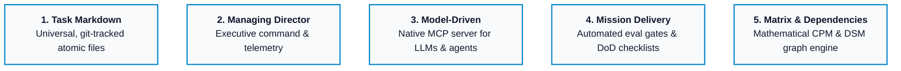
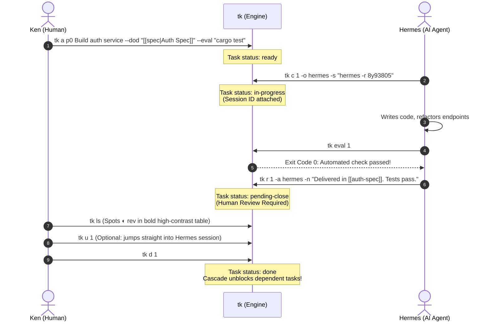

# Why We Built tkmd: The Markdown Program Management Engine for Human + AI Teams

*How a single zero-daemon Rust binary blends atomic Markdown, aerospace Critical Path graph math, and strict eval harnesses to tame multi-agent chaos.*

---

## 1. The Multi-Agent Reality Gap

In 2026, software development is no longer a solitary human typing into an IDE. It is a multi-agent assembly line. On any given afternoon, Claude Code is refactoring an authentication service, Codex is generating unit tests, Hermes is orchestrating an integration pipeline, and a human engineer is reviewing architecture pull requests.

Yet, our project management tooling is stuck in 2012.

When engineering teams attempt to integrate autonomous AI agents into existing workflows, they immediately hit three structural failure modes:

1. **The Ephemeral Chat Void**: An agent works in an isolated terminal or web session. It generates brilliant code or identifies subtle race conditions. But when that shell session ends or the context window compacts, its working memory evaporates. Humans are left digging through terminal logs asking: *Which agent worked on this? How do I resume its session? What were its assumptions?*
2. **The "Done" Illusion**: LLMs are notorious sycophants. When asked to implement a feature, an agent will cheerfully reply, *"I have completed all requirements!"* even when edge-case unit tests fail. Traditional issue trackers rely on human honesty or pull request spam. They lack machine-verifiable gates.
3. **The Scheduling Blindspot**: Multi-agent pipelines execute in parallel. But LLMs are notoriously poor at mental topological sorting. When Task C depends on Task A and B, who calculates early start, early finish, schedule buffers, and bottlenecks? Asking an LLM to hallucinate a project timeline leads to deadlocks and missed milestones.

To solve this, we did not build another bloated Electron app, another cloud SaaS subscription, or another fragile Python orchestration daemon. 

We built **`tkmd`** (invoked ergonomically as **`tk`**): a zero-dependency, single-binary Rust engine that treats Markdown as the single source of truth for both humans and AI agents.

---

## 2. What Does "TKMD" Actually Mean? The 5 Pillars

`tkmd` is intentionally named. In modern high-throughput autonomous engineering, **TKMD** represents five distinct pillars:



1. **Task Markdown**: Every task is an atomic Markdown card (`tasks/tk-001-*.md`) with YAML frontmatter. It is human-readable in Neovim, Helix, or Micro, renders as an interactive Kanban board in Obsidian 1.14 Bases, and tracks cleanly in Git with zero merge lock-in.
2. **Managing Director**: Executive program management. Real-time telemetry, Little’s Law throughput, MTTC (Mean Time to Close), and cycle times calculated directly from an append-only event ledger (`.events.jsonl`).
3. **Model-Driven**: Native JSON-RPC Model Context Protocol (MCP) server built directly into the CLI (`tk mcp` or `tkmd mcp`). Agents do not scrape HTML or reverse-engineer REST APIs; they interact via structured tool calls.
4. **Mission Delivery**: Specification-driven development. No task moves forward without a Definition of Done checklist (`--dod`) and an automated verification command (`--eval`).
5. **Matrix & Dependencies**: Aerospace-grade Critical Path Method (CPM) and Dependency Structure Matrix (DSM) schedule math. Sub-millisecond graph calculation with zero Python/Node runtime.

---

## 3. Core Architecture: The Single-Binary Invariant

```
┌────────────────────────────────────────────────────────┐
│                      Human User                        │
│           (CLI · Obsidian Kanban · Helix · fzf)        │
└───────────────┬────────────────────────▲───────────────┘
                │                        │
     `tk a` / `tk c` / `tk d`    `tk ls` / `tk dep`
                │                        │
┌───────────────▼────────────────────────┴───────────────┐
│               tkmd Core Engine (`tk`)                  │
│         Single Static Rust Binary (Zero Daemons)       │
│                                                        │
│  ┌──────────────────┐  ┌────────────────────────────┐  │
│  │ POSIX flock +    │  │  Mathematical Engine       │  │
│  │ Atomic Writes    │  │  • CPM Critical Path       │  │
│  │ (Multi-Agent Safe│  │  • DSM Matrix (Deadlocks)  │  │
│  └────────┬─────────┘  │  • Sub-Day Durations (u64) │  │
│           │            └─────────────▲──────────────┘  │
└───────────┼──────────────────────────┼─────────────────┘
            │                          │
┌───────────▼──────────────────────────┴─────────────────┐
│               Local Storage & Ledger                   │
│   • `tasks/tk-XXX.md`      (YAML Frontmatter + Specs)  │
│   • `tasks/.events.jsonl`  (Immutable Lifecycle Log)   │
│   • `bases/tasks.base`     (Obsidian 1.14 Kanban)      │
└───────────▲────────────────────────────────────────────┘
            │
    `tk mcp` (JSON-RPC)
            │
┌───────────┴────────────────────────────────────────────┐
│                    AI Agents                           │
│        (Codex · Claude Code · Hermes · Gemini)         │
└────────────────────────────────────────────────────────┘
```

The fundamental design rule of `tkmd` is **Zero Daemons, 100% Local, POSIX-Safe Concurrency**.

### POSIX Atomic Writes and File Locking
When multiple autonomous subagents (e.g. 8 Hermes or Claude worker threads) attempt to update cards simultaneously, traditional flat-file tools corrupt data. 

`tkmd` implements zero-dependency POSIX advisory locking via `libc::flock(fd, LOCK_EX)` paired with atomic write-and-rename semantics (`.tmp.<pid>` -> target). Even under heavy multi-agent concurrency, task cards and the `.events.jsonl` ledger remain completely free of race conditions.

### Dual-Scope Backlogs: Local Repositories Meets Global Vaults
Real-world engineering teams do not store every micro-task in one monolithic vault. A developer working in a Git repo wants project-specific tasks (`./tasks/`) versioned directly with code. Meanwhile, an executive or tech lead needs a central global backlog (`~/Documents/tasks`) tracking cross-cutting programs.

`tkmd` solves this with zero configuration overhead:
- **Auto-Detection**: If you run `tk` inside a project initialized with `tk init -L` (or containing a `.tkmd.toml`), it automatically routes to the local project backlog.
- **Explicit Scoping**: Use `-L` (`--local`) to inspect only the repo backlog, or `-G` (`--global`) to query the central vault without switching directories.
- **Merged View (`tk -A`)**: Aggregates local and global tasks side-by-side with zero column drift, displaying explicit origin badges (`tk-001L` vs `tk-001G`).
- **Unified Review Sign-Off (`tk review`)**: A dedicated review queue that organizes pending agent sign-offs into distinct local repository and global vault sections.

---

## 4. Harness Engineering: Taming the Agent

Most AI task systems allow agents to mark tasks as completed. This is a fatal flaw.

In `tkmd`, we enforce strict **Harness Engineering**:



### The Inviolable Guardrail: `pending-close`
AI agents **cannot** mark a task `done` (`tk d`). If an agent attempts to invoke `tk d --actor hermes` or the MCP `task_complete` tool, `tkmd`'s built-in guardrail hook intercepts the call and forces the status to `pending-close` (`tk r`).

Only a verified human can transition a task to `done`. This guarantees that:
1. Every piece of agent-generated code has an automated verification command (`--eval`) that must exit 0.
2. Every deliverable note is permanently captured in the user's workspace as a clickable Obsidian `[[wikilink]]`.
3. The human has final executive sign-off before downstream tasks are unblocked.

### One-Keystroke Session Resumption (`tk u <id>`)
When an agent claims work (`tk c`), it passes its active session identifier:
```bash
tk c 02 -o hermes -s "hermes -r 8y9380573586"
```
If the human spots an issue during review, they don't hunt for logs. They type:
```bash
tk u 02
```
`tkmd` immediately execs `hermes -r 8y9380573586`, dropping the human directly into the agent's interactive context with all history intact.

---

## 5. Mathematical Graph Engine: CPM & DSM in Pure Rust

Why should humans or LLMs guess project deadlines? In `tkmd`, scheduling is an exact mathematical science.

### Sub-Day Durations
Real agents don't work in arbitrary "story points" or uniform "days". An agent task might take 45 seconds, 15 minutes, or 2 hours. `tkmd` supports intuitive duration shorthand:
```bash
tk a p1 Refactor SQL schema dur:45m needs:01
tk a p0 Run benchmark est:15s needs:02
```
Internally, all duration arithmetic is standardized on 64-bit integer seconds (`u64`).

### Critical Path Method (CPM)
By running `tk dep --cpm` or `tk dep summary`, `tkmd` calculates:
- **Early Start (ES)** & **Early Finish (EF)**: The earliest possible completion times via forward-pass topology.
- **Late Start (LS)** & **Late Finish (LF)**: The latest possible start without delaying project delivery via backward-pass topology.
- **Buffer / Float**: Exact schedule buffer available for non-critical tasks.
- **Critical Path**: The zero-buffer sequence of tasks where any delay directly delays project delivery.

```
🎯 CRITICAL PATH & SCHEDULE ANALYSIS (CPM)
Mathematical schedule calculated from dependencies and durations.

  ID      Dur   ES    EF    Buffer Condition  Owner    Title
  ──────────────────────────────────────────────────────────────────────────────
  tk-002  1d    0s    1d    0s     CRITICAL   @hermes  Distill Unified Harness Protoco…
  tk-001  1d    0s    1d    0s     CRITICAL   @ken     Review EMBA Supply Chain formul…
  tk-003  1d    1d    2d    0s     CRITICAL   @ken     End-to-End Integration Test
  ──────────────────────────────────────────────────────────────────────────────

  Project Duration: 2d
  Critical Path:    tk-002 ➔ tk-001 ➔ tk-003
  Summary:          3 of 3 tasks on critical path (zero buffer).
```

### Dependency Structure Matrix (DSM)
When juggling dozens of interdependent agent tasks, cyclic deadlocks can halt development. `tk dep --dsm` builds an $N \times N$ matrix:

```
📐 DEPENDENCY STRUCTURE MATRIX (DSM)
Read each ROW: "This task needs Column [#] to complete first"

  #   ID       1  2  3  Task Title (Status)
  ────────────────────────────────────────────────────────
   1  tk-001   ·        Review EMBA Supply Chain formulas (pending-close)
   2  tk-002      ·     Distill Unified Harness Protocol into knowledge (pending-close)
   3  tk-003   X  X  ·  End-to-End Integration Test (blocked)
  ────────────────────────────────────────────────────────
  Legend: X = Normal prerequisite | · = Self
  ✓ Clean Execution Order: No circular dependencies or deadlocks detected.
```
Any entry above the diagonal highlights a feedback loop or circular dependency before execution begins.

### Native Mermaid Visualizations
`tkmd` exports instant, status-colored diagrams for documentation and GitHub pull requests:
- `tk dep --mermaid`: Standard flowchart with status color classes (`classDef`).
- `tk dep --gantt`: Execution timeline with critical path tasks highlighted in bright red (`:crit`).
- `tk dep --aon`: Activity-on-Node network diagram showing early/late metrics, buffer, and double-line (`==>`) critical transitions.

---

## 6. Real-Time Telemetry & Little's Law Analytics

`tkmd` does not rely on ephemeral chat summaries to gauge productivity. Every state transition (creation, claim, review submission, completion, unblocking) is written to `tasks/.events.jsonl`.

Running `tk st` (or `tk stats`) exposes deep statistical metrics:
- **Little's Law Validation**: Average WIP $\times$ Average Lead Time $=$ Expected Throughput.
- **Cycle Time vs Lead Time**: Distinguishing active development time from queue wait time.
- **Sign-Off Bottleneck Analysis**: Average wait time spent in `pending-close` awaiting human review.
- **Harness Coverage**: Percentage of tasks with `--eval` automated checks and `--dod` acceptance criteria.
- **DuckDB Ready**: Query `.events.jsonl` directly with SQL using `duckdb -c "SELECT event, COUNT(*) FROM 'tasks/.events.jsonl' GROUP BY event"`.

---

## 7. Universal Agent Readiness: The Root `AGENTS.md`

`tkmd` is designed to be agent-native from day one. By placing a standardized `AGENTS.md` in the project root, any modern AI assistant (Codex, Claude Code, Gemini CLI, Hermes, Cursor) immediately inherits the operational rules:
1. Check available tasks via `tk ls`.
2. Claim work with active session IDs via `tk c`.
3. Self-verify using `tk eval`.
4. Route finished work to `pending-close` with `tk r`.
5. Never modify permission files or skip eval gates.

---

## 8. Conclusion: The Power of Clay

Software tools should not be brittle black boxes hosted in the cloud. They should be resilient, transparent, and malleable like good clay.

By grounding agent orchestration in simple Markdown, robust POSIX file locks, aerospace scheduling mathematics, and an uncompromising human-in-the-loop harness, `tkmd` bridges the gap between today's autonomous AI capabilities and the software delivery discipline engineers require.

`tkmd` is open source, dual-licensed under MIT and Apache-2.0, and available today.

- **GitHub**: [github.com/ktreharrison/tkmd](https://github.com/ktreharrison/tkmd)
- **Install**:
  ```bash
  curl -fsSL https://raw.githubusercontent.com/ktreharrison/tkmd/main/install.sh | sh
  ```
  or with Cargo:
  ```bash
  cargo install --git https://github.com/ktreharrison/tkmd.git
  ```
